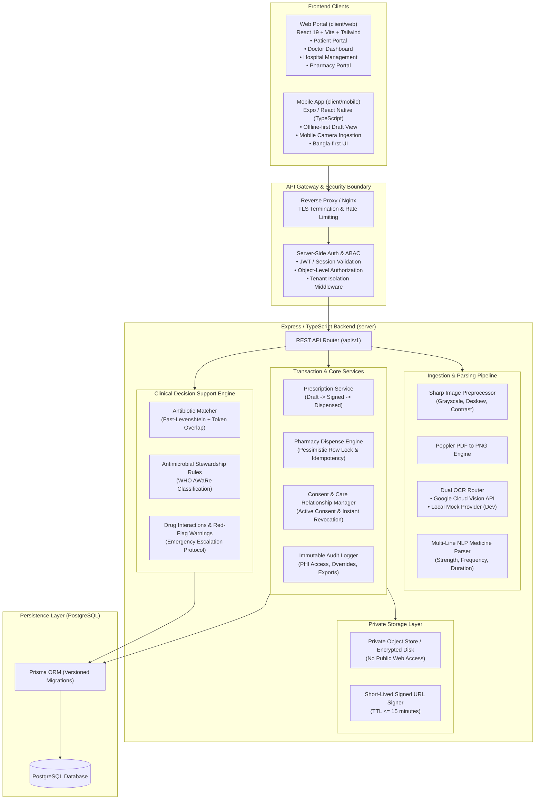
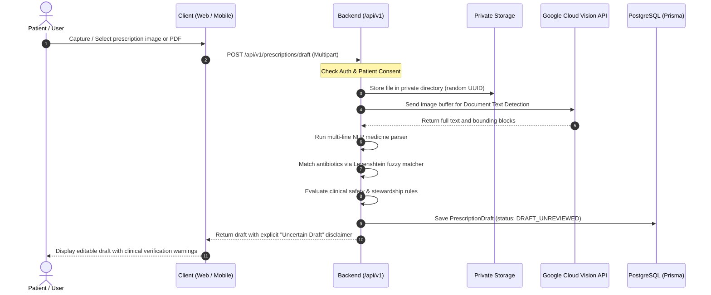
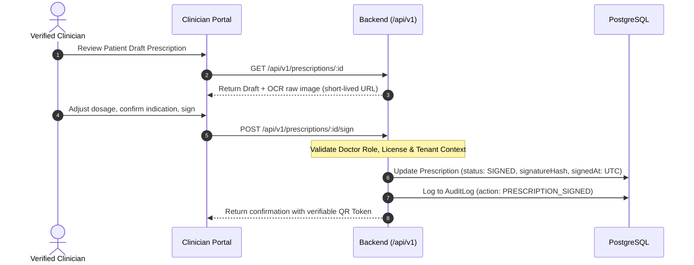
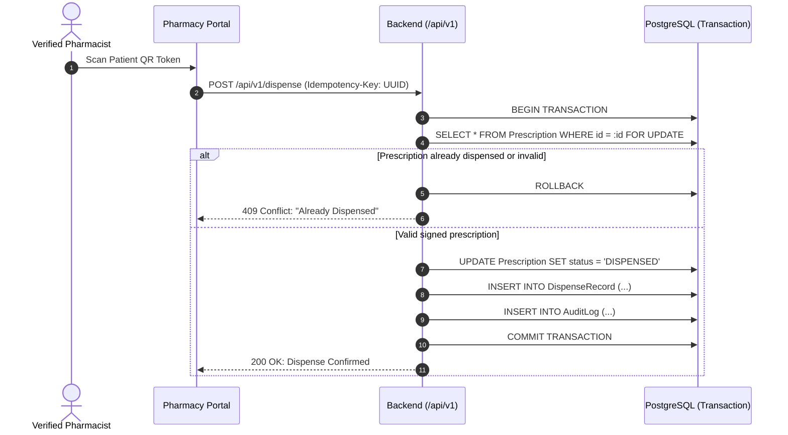

# 🏛 MedMinders Architecture Specification

## 1. Overview & Vision
MedMinders is a full-stack, clinical-grade digital health platform designed to bridge patients, registered healthcare providers, pharmacies, and hospital networks. The core purpose of the platform is to streamline prescription management, digitize handwritten and printed prescriptions through intelligent Optical Character Recognition (OCR), and provide antimicrobial stewardship alerts to prevent antibiotic misuse while enforcing rigorous clinical safety and data privacy boundaries.

---

## 2. Target Monorepo Topology

```text
MedMinders/
├── client/
│   ├── web/                     # Existing React 19 + Vite 6 + Tailwind CSS v4 portal
│   │   ├── src/                 # Web portal UI (Patient, Doctor, Hospital, Pharmacy)
│   │   ├── public/              # Static public web assets
│   │   ├── package.json
│   │   └── vite.config.js
│   └── mobile/                  # New Expo / React Native TypeScript application
│       ├── app/ or src/         # Mobile screens & navigation (Bangla-first, patient/doctor)
│       ├── package.json
│       └── app.json
├── server/                      # Node.js + Express + TypeScript backend
│   ├── prisma/                  # Versioned schema migrations & seeds
│   ├── src/
│   │   ├── controllers/         # REST API controller handlers
│   │   ├── middleware/          # Auth, ABAC, tenant isolation, rate limiting
│   │   ├── routes/              # Versioned API routes (/api/v1/...)
│   │   ├── services/            # OCR, NLP parser, antibiotic matcher, safety, storage
│   │   └── index.ts             # Express server bootstrap
│   ├── package.json
│   └── tsconfig.json
├── docs/                        # Engineering, clinical risk & governance specs
│   ├── architecture.md          # System architecture & data flow (this file)
│   ├── current-state.md         # Repository inventory & security audit
│   ├── permission-matrix.md     # RBAC & object-level authorization rules
│   ├── clinical-risk-register.md # Clinical safety hazards & mitigations
│   └── implementation-plan.md  # Sequential vertical slices & file migration plan
├── antibiotic_dose.xlsx         # Master clinical antibiotic dataset (Excel)
├── package.json                 # Monorepo root workspace configuration
└── README.md                    # Primary repository overview
```

---

## 3. High-Level System Architecture



---

## 4. Core Subsystems & Workflows

### 4.1 Ingestion & OCR Processing: "Draft Only" Paradigm
* **Clinical Principle**: OCR and fuzzy string matching generate **uncertain drafts only**. Algorithmic extractions are never silently converted into active prescriptions, patient charts, or medication intake schedules.
* **Dual Pipeline**:
  1. **Client-Side (Web / Mobile)**: Offline pre-validation using `tesseract.js` for instant feedback and edge processing.
  2. **Server-Side**: Canonical processing via Google Cloud Vision API preceded by `sharp` pre-processing (deskewing, contrast normalization, grayscale conversion) and `pdftoppm` for PDF ingestion.
* **Extraction Normalization**: The multi-line NLP parser matches drug entities, strengths (mg, ml, g), dosage forms (tablet, syrup, suspension, drops, injection), frequencies (`1+0+1`, `0+1+0`, `1+1+1`, OD, BD, TDS, QID), and durations (e.g. `7 days`, `৫ দিন`).



---

### 4.2 Clinician Review & Digital Signing Workflow
* **Clinical Principle**: An extracted draft becomes an actionable prescription **only** when a verified physician (with registered medical licensing/BMDC credentials) reviews, edits, and cryptographically signs it.
* **State Transition**: `DRAFT_UNREVIEWED` → `CLINICIAN_REVIEWED` → `SIGNED`.
* **Tamper Evident**: A SHA-256 digital hash of the clinician-verified items is generated upon signing.



---

### 4.3 Pharmacy Dispensing with Pessimistic Row Lock & Idempotency
* **Clinical Principle**: Prevent lethal duplicate dispensing of antibiotics or controlled substances across multiple pharmacies.
* **Dispensing Protocol**:
  1. Pharmacist scans QR or submits prescription verification token.
  2. Server opens an atomic PostgreSQL transaction with a pessimistic row lock (`FOR UPDATE`).
  3. Verifies current status is `SIGNED` and `dispensedStatus != FULLY_DISPENSED`.
  4. Requires `Idempotency-Key` header to prevent double submissions from network retries.
  5. Updates dispensing status to `DISPENSED`, records pharmacist ID, timestamp, and audit event within the transaction.



---

## 5. Storage & Privacy Architecture
* **Current Vulnerability**: The current repository serves files through `app.use('/uploads', express.static(...))`, exposing all medical files to anyone with a guessed URL.
* **Target Architecture**:
  1. Files are stored in a private directory outside web roots (or in private S3/GCS buckets).
  2. Access is mediated exclusively through authenticated endpoints:
     - `GET /api/v1/prescriptions/:id/file` validates user role, patient ownership, or active clinician care relationship.
     - Files are streamed with `Cache-Control: private, no-store` or signed with short-lived tokens (TTL $\le$ 15 minutes).
  3. Files are encrypted at rest where the underlying filesystem or bucket supports KMS.

---

## 6. Internationalization & Localization (i18n)
* **Bangla-First UX**:
  - Primary UI labels, dosage instructions, and patient safety alerts are rendered in standard Bengali with clear typography.
  - Frequency patterns like `1+0+1` are translated into intuitive Bengali terms (যেমন: "সকাল ১টি + রাত ১টি, দুপুরে প্রয়োজন নেই").
* **Timestamp & Timezone Standard**:
  - All timestamps are persisted in PostgreSQL in **UTC** (`TIMESTAMPTZ`).
  - Client applications convert and display dates in **Asia/Dhaka** local time (`BST`, UTC+6).
