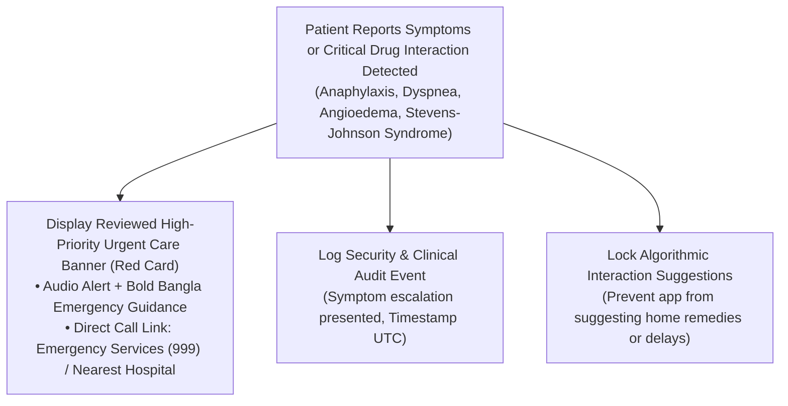
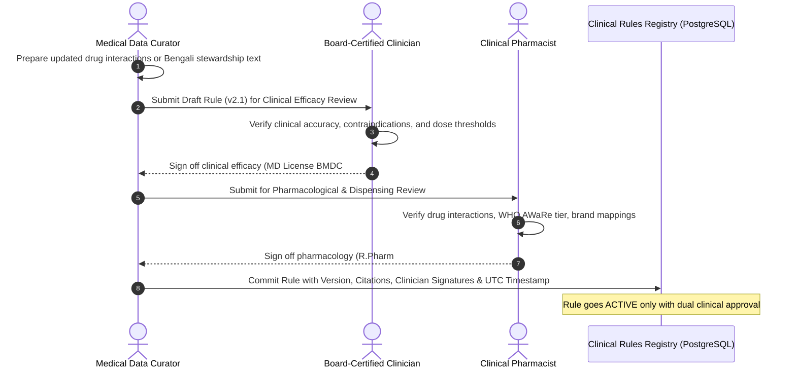

# 🩺 MedMinders Clinical Risk Register & Safety Protocol

## 1. Clinical Principles & Non-Negotiable Boundaries

MedMinders is designed to assist patients and registered clinicians, not replace clinical judgement. The platform operates under the following mandatory clinical safety constraints:

1. **Uncertain Draft Paradigm**: Optical Character Recognition (OCR) and fuzzy matching algorithm outputs are strictly classified as **`DRAFT_UNREVIEWED`**. They must never be silently promoted to an active prescription, medical order, or medication schedule.
2. **Provider Exclusivity for Prescribing**: Only a verified doctor with an authenticated medical council registration (e.g. BMDC) may sign and authorize a prescription.
3. **Provider Exclusivity for Dispensing**: Only a verified pharmacy professional may mark a medication as dispensed.
4. **Prohibition of Autonomous Clinical Decisions**:
   - The platform **shall never diagnose** an illness.
   - The platform **shall never alter, increase, or decrease a drug dose or duration**.
   - The platform **shall never infer an individual patient’s antimicrobial resistance (AMR)** from general datasets.
   - The platform **shall never instruct a patient to discontinue or substitute an antibiotic autonomously**.
5. **WHO AWaRe Classification Context**: The WHO AWaRe categorization (Access, Watch, Reserve) is an **epidemiological stewardship classification** for antimicrobial stewardship; it is **never a patient diagnosis** or personal therapeutic recommendation.
6. **Emergency Escalation Protocol**: The platform is **not** an emergency dispatch service. For acute or severe symptoms, it displays reviewed urgent-care escalation guidance directing the patient to immediate emergency hospital services.
7. **Approved Bengali Patient Education**: All Bengali educational text, stewardship alerts, and symptom advisories must record the clinical source, version identifier, and approval stamp of a registered physician or clinical pharmacist.

---

## 2. Clinical Risk Assessment Matrix

| Risk ID | Hazard Description | Pre-Mitigation Risk | Root Cause / Failure Mode | Mandatory Technical & Clinical Mitigations | Post-Mitigation Risk |
|---|---|---|---|---|---|
| **CR-01** | **OCR Halting / Misinterpretation Leading to Lethal Overdose** | **CRITICAL** (Catastrophic x Likely) | Handwritten doctor notes misread (e.g. `50mg` misread as `500mg`, or `OD` misread as `TDS`). | 1. Extractions stored strictly with `isDraft: true`, `status: DRAFT_UNREVIEWED`. 2. Clear visual banner: "খসড়া প্রেসক্রিপশন - ডাক্তারের যাচাই ব্যতীত ঔষধ গ্রহণ নিষেধ". 3. Patient cannot convert draft into active reminder without doctor review. 4. Verified physician must review original image alongside parsed text before signing. | **LOW** (Minor x Unlikely) |
| **CR-02** | **Duplicate Dispensing Across Multiple Pharmacies** | **HIGH** (Major x Possible) | Patient presents digital QR code to multiple pharmacies to obtain duplicate quantities of antibiotics or controlled drugs. | 1. Atomic PostgreSQL transaction with pessimistic row locking (`SELECT ... FOR UPDATE`). 2. Unique `Idempotency-Key` requirement on dispense endpoint. 3. State transition from `SIGNED` to `DISPENSED` is irreversible without clinical audit override. 4. Re-dispensing attempt returns immediate `409 Conflict: Already Dispensed` with timestamp and dispensing pharmacy details. | **LOW** (Minor x Unlikely) |
| **CR-03** | **Premature Antibiotic Cessation Due to Misunderstood Alert** | **HIGH** (Major x Likely) | Patient reads a generic side-effect or stewardship warning and abruptly stops antibiotic course, causing treatment failure and bacterial resistance. | 1. Strict copy review: Every alert emphasizes "কোর্স সম্পন্ন করুন - ডাক্তারের নির্দেশ ব্যতীত কোনোভাবেই অ্যান্টিবায়োটিক বন্ধ করবেন না". 2. Clear distinction between mild expected side effects (e.g. mild nausea) and acute emergencies. 3. Clinician sign-off on all patient-facing guidance copy. | **LOW** (Minor x Unlikely) |
| **CR-04** | **Delayed Emergency Care for Acute Allergic Reactions (Anaphylaxis)** | **CRITICAL** (Catastrophic x Possible) | Patient experiences life-threatening drug reaction (e.g. swelling of throat, severe breathing difficulty) and seeks in-app advice instead of 999/emergency room. | 1. Red-flag symptom engine detects high-risk keywords (অ্যালার্জি, শ্বাসকষ্ট, অ্যানাফিল্যাক্সিস, বুকে ব্যথা). 2. Displays high-contrast Red Escalation Card with emergency guidance: "এটি একটি জরুরি অবস্থা! অবিলম্বে নিকটস্থ হাসপাতালের জরুরি বিভাগে যান বা অ্যাম্বুলেন্স ডাকুন। অ্যাপে সময় নষ্ট করবেন না।" 3. Disclaims all emergency service functionality. | **LOW** (Moderate x Unlikely) |
| **CR-05** | **Misinterpretation of WHO AWaRe Classification** | **MEDIUM** (Moderate x Possible) | Patient sees "Watch Group Antibiotic" and believes their condition is terminal or dangerous. | 1. Contextual tooltip explaining that AWaRe is an international public health stewardship guide for doctors, not an indicator of personal illness severity. 2. Reviewed Bengali educational text explaining the concept in non-alarmist terms. | **LOW** (Negligible x Unlikely) |
| **CR-06** | **Unauthorized PHI Leakage via Push / SMS Notifications** | **HIGH** (Major x Possible) | Background push notifications display specific medication names (e.g. "Take your Ciprofloxacin 500mg") visible on locked mobile screens to bystanders. | 1. Absolute rule: **Zero PHI in push / SMS payloads**. 2. Push notifications contain only generic reminders: "মেডমাইন্ডার্স: আপনার ঔষধ সেবনের নির্ধারিত সময় হয়েছে। বিস্তারিত দেখতে অ্যাপটি খুলুন।" 3. Sensitive clinical details retrieved only within authenticated app session. | **LOW** (Negligible x Unlikely) |

---

## 3. Red-Flag Symptom Escalation Protocol

When any of the following high-risk conditions or symptom combinations are detected in patient inputs or medication interactions:

### Approved Emergency Escalation Copy (Bengali & English):
* **Bengali**:
  > 🚨 **জরুরি স্বাস্থ্য সতর্কতা (Urgent Medical Attention Required)**  
  > আপনার উল্লিখিত লক্ষণসমূহ (যেমন: তীব্র শ্বাসকষ্ট, গলা বা মুখ ফুলে যাওয়া, প্রচণ্ড অ্যালার্জি) একটি আশঙ্কাজনক পার্শ্বপ্রতিক্রিয়া হতে পারে।  
  > **অনুগ্রহ করে কোনো প্রকার অপেক্ষা না করে অবিলম্বে নিকটস্থ হাসপাতালের জরুরি বিভাগে যান অথবা জাতীয় জরুরি সেবা ৯৯৯-এ কল করুন।**  
  > *মেডমাইন্ডার্স কোনো জরুরি সেবা প্রদানকারী সংস্থা নয়।*
* **English**:
  > 🚨 **Urgent Medical Attention Required**  
  > The symptoms described may indicate an acute adverse reaction requiring immediate intervention.  
  > **Proceed immediately to the nearest hospital emergency department or call emergency services (999). Do not wait for an in-app consultation.**  
  > *MedMinders is not an emergency medical service.*

---

## 4. Clinical Knowledge Base Governance & Approval Workflow

* **Data Provenance Requirements**:
  - Every clinical rule, interaction entry, and educational snippet must retain:
    - `ruleId`: Unique UUID.
    - `version`: SemVer string (e.g. `1.2.0`).
    - `sourceCitation`: Medical literature or regulatory guideline (e.g., *WHO Model List of Essential Medicines 2023*, *Bangladesh National Drug Policy*).
    - `approvedByClinicianId`: Verified physician identifier.
    - `approvedByPharmacistId`: Verified pharmacist identifier.
    - `approvedAt`: ISO 8601 UTC timestamp.
