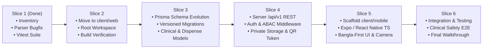

# 📋 MedMinders Sequential Implementation Plan

## 1. Component Reuse, Refactor & Replace Matrix

Based on our direct code inspection and build audit, here is the concrete inventory of repository components:

| Existing Component | Current File Location | Disposition | Evidence & Rationale |
|---|---|---|---|
| **Landing & Marketing Pages** | `src/pages/Home.jsx`, `AboutPage.jsx`, `ServicesPage.jsx`, `Contact.jsx`, `Hero.jsx`, `DoctorsSection.jsx` | **REUSE** | Solid React 19 UI with Three.js graphics and Framer Motion. Keep intact; move safely to `client/web`. |
| **Patient Dashboard UI** | `src/components/home/Patient/PatientDashboard.jsx` | **REFACTOR** | Replace hardcoded mock patient data (`Mohammad Rahman`) and static lab reports with authenticated `/api/v1/patient/profile` and `/api/v1/prescriptions` API calls. |
| **Prescription Scanner Modal** | `src/components/home/Patient/PrescriptionUploadModal.jsx` | **REFACTOR** | Retain in-browser `tesseract.js` worker as client fallback. Update to submit file to `/api/v1/prescriptions/draft` and display mandatory "Uncertain Draft" disclaimer banner. |
| **Prescription Results View** | `src/components/home/Patient/PrescriptionResults.jsx` | **REFACTOR** | Ensure parsed medicines are clearly tagged as `DRAFT_UNREVIEWED`. Add clinical emergency card for red-flag symptoms. |
| **Doctor Auth & Portal** | `src/components/home/DoctorAuth.jsx`, `src/components/home/Doctor/*` | **REFACTOR** | Replace local `useState` mock authentication with real `/api/v1/auth/doctor/login` and credential verification status check (`DOCTOR_VERIFIED` vs `DOCTOR_UNVERIFIED`). Add digital signing view. |
| **Hospital & Pharmacy Portals** | `src/components/home/Hospital/*`, `src/components/home/Pharmacy/*` | **REFACTOR** | Connect Pharmacy UI to `/api/v1/dispense/verify-token` and `/api/v1/dispense/confirm` with atomic locking. Connect Hospital UI to tenant-isolated department endpoints. |
| **Client Medicine Parser** | `src/utils/medicineParser.js` | **REUSE** | Updated in Slice 1 with multi-line continuation handling. Retain for instant client-side OCR parsing preview. |
| **Client Antibiotic Matcher** | `src/utils/antibioticMatcher.js` & `src/data/antibiotics.json` | **REUSE** | Retain as offline fallback client dataset for instant offline matching. |
| **Client Safety Alerts** | `src/utils/safetyAlerts.js` | **REFACTOR** | Add version stamping, source citation display, and clinician-reviewed emergency escalation copy. |
| **Server OCR Providers** | `server/src/services/ocr/*` | **REUSE** | Google Cloud Vision provider, Mock provider, and Sharp preprocessor are well structured. |
| **Server Medicine Parser** | `server/src/services/parser/medicineParser.ts` | **REUSE** | Syntax bug fixed and multi-line parsing verified via Vitest in Slice 1. |
| **Server Antibiotic Matcher** | `server/src/services/antibiotics/matcher.ts` | **REFACTOR** | Optimize `prisma.antibiotic.findMany()` to use an in-memory cache/trie rather than scanning the DB on every single medicine parsed. |
| **XLSX Import Engine** | `server/src/services/antibiotics/xlsxImport.ts` | **REUSE** | Efficient Bengali header mapping and forward-fill normalization for `antibiotic_dose.xlsx`. |
| **Server Storage Engine** | `server/src/services/storage.ts` | **REPLACE** | Replace public `/uploads` directory and `express.static` with private storage and authenticated/signed streaming URLs. |
| **Server Controllers & Routes** | `server/src/controllers/*`, `server/src/routes/*` | **REFACTOR** | Restructure into versioned `/api/v1` routes with JWT authentication and object-level authorization (ABAC). |
| **Prisma Schema** | `server/prisma/schema.prisma` | **REFACTOR** | Evolve from 4 basic models into enterprise clinical schema using versioned migrations (`prisma migrate dev`). |

---

## 2. Directory Reorganization Plan: Safe Move to `client/web`

### 2.1 Target Structure
```text
MedMinders/
├── client/
│   ├── web/                     # Existing React/Vite web application
│   └── mobile/                  # New Expo / React Native app
├── server/                      # Existing Express / TypeScript server
├── docs/                        # Specifications & documentation
├── antibiotic_dose.xlsx
├── package.json                 # Monorepo root workspace
└── README.md
```

### 2.2 Step-by-Step Move Commands (Slice 2 Execution)
To prevent any data loss or broken imports, the move will be performed via git and verified immediately:

```bash
# 1. Create client directory
mkdir client
mkdir client/web

# 2. Move web portal files into client/web using git mv
git mv src client/web/src
git mv public client/web/public
git mv index.html client/web/index.html
git mv vite.config.js client/web/vite.config.js
git mv eslint.config.js client/web/eslint.config.js
git mv package.json client/web/package.json
git mv package-lock.json client/web/package-lock.json

# 3. Create root package.json for npm workspaces
# Root package.json will define:
# {
#   "name": "medminders-workspace",
#   "private": true,
#   "workspaces": ["client/web", "client/mobile", "server"]
# }

# 4. Verify client/web independently
cd client/web
npm install
npm run build
```

### 2.3 Rollback Plan for Slice 2
If `client/web` build fails or cannot be verified:
```bash
git checkout HEAD -- .
git clean -fd client/
```
No database migrations or irreversible file modifications are involved in this transition.

---

## 3. Sequential Vertical Slices Roadmap



### Slice 1 (Completed in previous step):
* Fixed syntax and type errors in `server/src/services/parser/medicineParser.ts` and `mockOcrProvider.ts`.
* Configured Vitest and verified unit test execution.
* Fixed multi-line prescription token aggregation in NLP parsers.

### Slice 2: Safe Move of Web Portal to `client/web`
* State: Files to move: `src/`, `public/`, `index.html`, `vite.config.js`, `eslint.config.js`, `package.json`, `package-lock.json` -> `client/web/`.
* Root workspace configuration created.
* Verification: Run `npm run build` in `client/web`, run server build and test in `server`.

### Slice 3: Database Schema Evolution & Versioned Migrations
* Files to change: `server/prisma/schema.prisma`, `server/prisma/seed.ts`, `server/prisma/migrations/*`.
* Add models: `Organization` (Tenant), `PatientProfile`, `ClinicianProfile`, `PharmacistProfile`, `Prescription` (with `status`: `DRAFT_UNREVIEWED`, `CLINICIAN_REVIEWED`, `SIGNED`, `DISPENSED`, `CANCELLED`), `PrescriptionItem`, `DispenseRecord` (with row-lock support & idempotency key), `ConsentRecord`, `AuditLog`, `ClinicalRuleVersion`.
* Run `npx prisma migrate dev --name init_clinical_schema`.
* Update seed script with clinical demo data (no real patient data).

### Slice 4: Server Core & Security (`/api/v1`)
* Files to change: `server/src/middleware/auth.ts`, `server/src/middleware/abac.ts`, `server/src/routes/v1/*`, `server/src/services/storage.ts`.
* Implement JWT authentication, role verification, and object-level authorization on every PHI route.
* Remove public `/uploads` static file exposure; create authenticated streaming with short-lived access.
* Implement pharmacy QR verification token generation and atomic dispensing endpoint with pessimistic row locking.
* Add OpenAPI/Swagger documentation at `/api/v1/docs`.

### Slice 5: Expo / React Native TypeScript Mobile App (`client/mobile`)
* Scaffold new Expo app under `client/mobile` using TypeScript.
* Implement Bangla-first accessible UI with Asia/Dhaka localized date/time formatting.
* Build Patient Flow: View prescriptions, camera-based prescription draft upload, display explicit "Uncertain Draft" disclosures, QR code display for pharmacy dispensing.
* Build Doctor Flow: Review patient drafts alongside original image, edit items, digital signature confirmation.

### Slice 6: Cross-Platform Integration & Verification
* Connect `client/web` and `client/mobile` to `/api/v1`.
* Run comprehensive automated tests (parser tests, ABAC authorization tests, atomic duplicate dispensing tests).
* Document end-to-end walkthrough artifact.

---

## 4. Unanswered Questions & Architectural Decisions

The following items are documented for ongoing review and do not block safe scaffolding:

1. **Production File Storage Provider**:
   - *Current*: Local encrypted disk with private streaming.
   - *Question for Production*: AWS S3 with KMS vs Google Cloud Storage vs Supabase Private Bucket?
   - *Default Scaffolding*: Pluggable storage abstraction (`StorageService` interface) defaulting to local private directory in development.
2. **Clinician Licensing Verification (BMDC)**:
   - *Question*: Is there an automated BMDC (Bangladesh Medical & Dental Council) verification API available, or will doctor verification rely on administrator manual review of uploaded license credentials?
   - *Default Scaffolding*: Support `DOCTOR_UNVERIFIED` state with admin approval endpoint (`POST /api/v1/admin/clinicians/:id/verify`).
3. **SMS / Push Notification Gateway**:
   - *Question*: Which SMS gateway is preferred for Bangladesh (e.g. SSL Wireless, Banglalink/Grameenphone API, or Twilio)?
   - *Default Scaffolding*: Generic notification service interface ensuring **zero PHI** in notification payloads.
4. **Offline Mobile Synchronization**:
   - *Question*: Will patients need full offline prescription history with SQLite/WatermelonDB, or is lightweight AsyncStorage caching of recent signed prescriptions sufficient?
   - *Default Scaffolding*: AsyncStorage caching for offline viewing of recent prescriptions.
