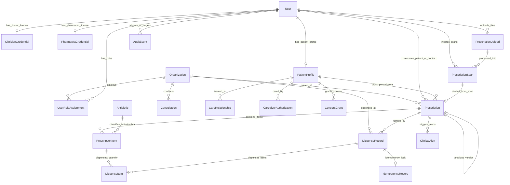

# 🗄️ MedMinders Database Schema Evolution & ERD Specification

## 1. Entity Relationship Diagram (ERD)



---

## 2. Table Specifications & Database Constraints

### 2.1 Identity, Tenancy & Roles
* **`Organization`**:
  - `id`: UUID (Primary Key)
  - `name`: VARCHAR(255)
  - `type`: `HOSPITAL` | `CLINIC` | `PHARMACY` | `DIAGNOSTIC`
  - `regNumber`: VARCHAR(100) UNIQUE
  - `isActive`: BOOLEAN (default true)
* **`User`**:
  - `id`: UUID (Primary Key, legacy cuid compatible)
  - `email`: VARCHAR(255) UNIQUE
  - `phoneNumber`: VARCHAR(50) UNIQUE (nullable for legacy)
  - `passwordHash`: VARCHAR(255) (nullable for legacy)
  - `legacyRole`: VARCHAR(50) (mapped from legacy `role` column)
  - `isActive`: BOOLEAN (default true)
* **`UserRoleAssignment`**:
  - `id`: UUID (Primary Key)
  - `userId`: UUID (FK -> `User.id` ON DELETE CASCADE)
  - `organizationId`: UUID (FK -> `Organization.id` ON DELETE SET NULL, nullable)
  - `role`: `PATIENT` | `CAREGIVER` | `DOCTOR` | `PHARMACIST` | `HOSPITAL_ADMIN` | `SUPERADMIN`
  - `isVerified`: BOOLEAN (default false)
  - `verifiedAt`: TIMESTAMPTZ (nullable)
  - `CONSTRAINT uq_user_role_org UNIQUE (userId, role, organizationId)`
* **`ClinicianCredential`**:
  - `id`: UUID (Primary Key)
  - `userId`: UUID UNIQUE (FK -> `User.id` ON DELETE CASCADE)
  - `bmdcNumber`: VARCHAR(100) UNIQUE NOT NULL (BMDC Registration Number)
  - `specialty`: VARCHAR(150)
  - `verificationStatus`: `PENDING` | `VERIFIED` | `REJECTED` | `SUSPENDED` (default `PENDING`)
* **`PharmacistCredential`**:
  - `id`: UUID (Primary Key)
  - `userId`: UUID UNIQUE (FK -> `User.id` ON DELETE CASCADE)
  - `licenseNumber`: VARCHAR(100) UNIQUE NOT NULL (Pharmacy Council Registration)
  - `verificationStatus`: `PENDING` | `VERIFIED` | `REJECTED` (default `PENDING`)

### 2.2 Patient Profiles, Care Relationships & Consent
* **`PatientProfile`**:
  - `id`: UUID (Primary Key)
  - `userId`: UUID UNIQUE (FK -> `User.id` ON DELETE CASCADE)
  - `fullName`: VARCHAR(255)
  - `dateOfBirth`: DATE
  - `gender`: VARCHAR(50)
  - `bloodGroup`: VARCHAR(10)
  - `allergiesJson`: TEXT (default '[]')
  - `chronicConditionsJson`: TEXT (default '[]')
* **`CareRelationship`**:
  - `id`: UUID (Primary Key)
  - `patientId`: UUID (FK -> `User.id` ON DELETE CASCADE)
  - `clinicianId`: UUID (FK -> `User.id` ON DELETE RESTRICT)
  - `organizationId`: UUID (FK -> `Organization.id` ON DELETE SET NULL)
  - `relationshipType`: `ATTENDING` | `CONSULTING` | `EMERGENCY_REFERRAL`
  - `isActive`: BOOLEAN (default true)
* **`ConsentGrant`**:
  - `id`: UUID (Primary Key)
  - `patientId`: UUID (FK -> `User.id` ON DELETE CASCADE)
  - `granteeUserId`: UUID (FK -> `User.id` ON DELETE CASCADE)
  - `granteeOrganizationId`: UUID (FK -> `Organization.id` ON DELETE SET NULL)
  - `purpose`: `CLINICAL_CARE` | `DISPENSING` | `DIAGNOSTIC_REVIEW`
  - `status`: `ACTIVE` | `REVOKED` | `EXPIRED`
  - `grantedAt`: TIMESTAMPTZ (default NOW())
  - `expiresAt`: TIMESTAMPTZ NOT NULL
  - `revokedAt`: TIMESTAMPTZ (nullable)
  - `CONSTRAINT chk_consent_revocation CHECK (revokedAt IS NULL OR revokedAt >= grantedAt)`

### 2.3 Prescriptions, Scans & Clinical Alerts
* **`PrescriptionUpload`** (Preserved Legacy Table):
  - `id`: String (PK)
  - `userId`: String (FK -> `User.id`)
  - `fileType`: String
  - `fileUrl`: String
  - `createdAt`: TIMESTAMPTZ
* **`PrescriptionScan`** (Preserved Legacy Table):
  - `id`: String (PK)
  - `uploadId`: String (FK -> `PrescriptionUpload.id`)
  - `userId`: String (FK -> `User.id`)
  - `ocrText`: TEXT
  - `ocrConfidence`: FLOAT
  - `medicinesJson`: TEXT
  - `antibioticsJson`: TEXT
  - `alertsJson`: TEXT
  - `status`: `DRAFT_UNREVIEWED` (Non-negotiable clinical safety status)
* **`Prescription`** (The Canonical Clinical Record):
  - `id`: UUID (Primary Key)
  - `organizationId`: UUID (FK -> `Organization.id` ON DELETE SET NULL)
  - `patientId`: UUID (FK -> `User.id` ON DELETE RESTRICT)
  - `prescriberId`: UUID (FK -> `User.id` ON DELETE RESTRICT, verified doctor)
  - `scanId`: String (FK -> `PrescriptionScan.id` ON DELETE SET NULL, nullable linkage to OCR draft)
  - `status`: `DRAFT_UNREVIEWED` | `CLINICIAN_REVIEWED` | `SIGNED` | `DISPENSED` | `CANCELLED` (default `DRAFT_UNREVIEWED`)
  - `version`: INT (default 1)
  - `previousVersionId`: UUID (FK -> `Prescription.id` ON DELETE SET NULL)
  - `isLatestVersion`: BOOLEAN (default true)
  - `signatureHash`: VARCHAR(255) (SHA-256 digital signature of prescription payload)
  - `signedAt`: TIMESTAMPTZ (nullable, required when status is `SIGNED`)
  - `verificationToken`: VARCHAR(100) UNIQUE (scoped token for pharmacy QR code verification)
  - `tokenExpiresAt`: TIMESTAMPTZ (nullable)
  - `CONSTRAINT chk_token_expiry CHECK (tokenExpiresAt IS NULL OR tokenExpiresAt >= createdAt)`
* **`PrescriptionItem`**:
  - `id`: UUID (Primary Key)
  - `prescriptionId`: UUID (FK -> `Prescription.id` ON DELETE CASCADE)
  - `medicineName`: VARCHAR(255) NOT NULL
  - `genericName`: VARCHAR(255)
  - `form`: VARCHAR(100)
  - `strength`: VARCHAR(100)
  - `frequency`: VARCHAR(100)
  - `duration`: VARCHAR(100)
  - `prescribedQuantity`: INT NOT NULL
  - `dispensedQuantity`: INT NOT NULL DEFAULT 0
  - `isAntibiotic`: BOOLEAN DEFAULT false
  - `antibioticId`: String (FK -> `Antibiotic.id` ON DELETE SET NULL)
  - `CONSTRAINT chk_prescribed_qty CHECK (prescribedQuantity > 0)`
  - `CONSTRAINT chk_dispensed_qty CHECK (dispensedQuantity >= 0 AND dispensedQuantity <= prescribedQuantity)`

### 2.4 Pharmacy Dispensing & Idempotency
* **`DispenseRecord`**:
  - `id`: UUID (Primary Key)
  - `prescriptionId`: UUID (FK -> `Prescription.id` ON DELETE RESTRICT)
  - `organizationId`: UUID (FK -> `Organization.id` ON DELETE RESTRICT)
  - `pharmacistId`: UUID (FK -> `User.id` ON DELETE RESTRICT, verified pharmacist)
  - `dispenseStatus`: `PARTIAL` | `COMPLETED` | `REJECTED`
  - `idempotencyKey`: VARCHAR(100) UNIQUE NOT NULL
  - `dispensedAt`: TIMESTAMPTZ (default NOW())
* **`DispenseItem`**:
  - `id`: UUID (Primary Key)
  - `dispenseRecordId`: UUID (FK -> `DispenseRecord.id` ON DELETE CASCADE)
  - `prescriptionItemId`: UUID (FK -> `PrescriptionItem.id` ON DELETE RESTRICT)
  - `quantityDispensed`: INT NOT NULL
  - `batchNumber`: VARCHAR(100)
  - `expiryDate`: DATE
  - `CONSTRAINT chk_dispense_item_qty CHECK (quantityDispensed > 0)`
* **`IdempotencyRecord`**:
  - `id`: UUID (Primary Key)
  - `idempotencyKey`: VARCHAR(100) NOT NULL
  - `endpoint`: VARCHAR(255) NOT NULL
  - `requestHash`: VARCHAR(255) NOT NULL
  - `responseStatus`: INT
  - `responseBodyJson`: TEXT
  - `lockedUntil`: TIMESTAMPTZ NOT NULL
  - `CONSTRAINT uq_idempotency_key_endpoint UNIQUE (idempotencyKey, endpoint)`

### 2.5 Audit Logging
* **`AuditEvent`**:
  - `id`: UUID (Primary Key)
  - `actorUserId`: UUID (FK -> `User.id` ON DELETE SET NULL)
  - `targetUserId`: UUID (FK -> `User.id` ON DELETE SET NULL)
  - `organizationId`: UUID (FK -> `Organization.id` ON DELETE SET NULL)
  - `action`: VARCHAR(100) NOT NULL (`PHI_VIEW_PRESCRIPTION`, `PRESCRIPTION_SIGNED`, `MEDICATION_DISPENSED`, `CONSENT_REVOKED`, etc.)
  - `entityType`: VARCHAR(100) NOT NULL
  - `entityId`: VARCHAR(255) NOT NULL
  - `ipAddress`: VARCHAR(45)
  - `userAgent`: TEXT
  - `metadataJson`: TEXT
  - `occurredAt`: TIMESTAMPTZ (default NOW())

---

## 3. Indexes & Tenant Performance Optimizations

```sql
-- Audit Trail Indexes
CREATE INDEX idx_audit_occurred_at ON "AuditEvent" ("occurredAt" DESC);
CREATE INDEX idx_audit_actor ON "AuditEvent" ("actorUserId");
CREATE INDEX idx_audit_target ON "AuditEvent" ("targetUserId");
CREATE INDEX idx_audit_tenant ON "AuditEvent" ("organizationId", "occurredAt" DESC);

-- Prescription & Patient Lookups
CREATE INDEX idx_prescription_patient_latest ON "Prescription" ("patientId", "isLatestVersion");
CREATE INDEX idx_prescription_token ON "Prescription" ("verificationToken");
CREATE INDEX idx_prescription_org_status ON "Prescription" ("organizationId", "status");

-- Dispensing & Concurrency Locks
CREATE INDEX idx_dispense_prescription ON "DispenseRecord" ("prescriptionId");
CREATE INDEX idx_idempotency_key_lookup ON "IdempotencyRecord" ("idempotencyKey", "endpoint");
CREATE INDEX idx_idempotency_lock ON "IdempotencyRecord" ("lockedUntil");

-- Consent Validity Checks
CREATE INDEX idx_consent_patient_active ON "ConsentGrant" ("patientId", "status", "expiresAt");
```

---

## 4. Legacy Data Backfill & Migration Strategy

1. **User Migration**:
   - Existing records in `User` have `role` (`"patient" | "doctor" | "admin"`).
   - The migration retains `User` table, adds `legacyRole`, and creates corresponding `UserRoleAssignment` entries:
     - `'patient'` -> `role: PATIENT, isVerified: true`
     - `'doctor'` -> `role: DOCTOR, isVerified: false` (requires BMDC verification)
     - `'admin'` -> `role: SUPERADMIN, isVerified: true`
2. **PrescriptionScan Integrity**:
   - All existing `PrescriptionScan` records remain explicitly mapped with status `DRAFT_UNREVIEWED`.
   - **No Prescription records are synthesized from scans** during migration.

---

## 5. Rollback Strategy

If a migration rollback is required:
1. Every migration step is accompanied by a reverse SQL script (`down.sql`).
2. Dropping newly added tables in reverse topological order:
   `DispenseItem` -> `DispenseRecord` -> `IdempotencyRecord` -> `ClinicalAlert` -> `PrescriptionItem` -> `Prescription` -> `ConsentGrant` -> `CareRelationship` -> `CaregiverAuthorization` -> `PatientProfile` -> `ClinicianCredential` -> `PharmacistCredential` -> `UserRoleAssignment` -> `Organization` -> `AuditEvent`.
3. The legacy tables (`User`, `PrescriptionUpload`, `PrescriptionScan`, `Antibiotic`) remain strictly preserved with zero data loss.
